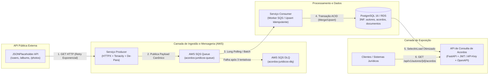

# Case Técnico: Consumo de API, Persistência e API de Consulta de Acordos Jurídicos (AWS)

Solução completa ponta a ponta desenvolvida em **Python 3.12**, **FastAPI**, **SQLAlchemy 2.0**, **PostgreSQL 16** e **AWS SQS (LocalStack)** para modernizar o consumo, transformação (De-Para), persistência assíncrona resiliente e exposição RESTful de acordos jurídicos.

---

## 1. Visão Geral da Arquitetura

A arquitetura segue o padrão **Event-Driven Microservices (Produtor → Fila SQS → Consumidor → Banco Relacional → API REST)**, garantindo desacoplamento, tolerância a falhas com Dead Letter Queue (DLQ) e idempotência no processamento.



---

## 2. Mapeamento Funcional e De-Para Obrigatório

Hierarquia de domínio: **Autor (1) → (N) Acordos (1) → (N) Documentos**.

| Origem (API Pública JSONPlaceholder) | Destino (API de Acordos Jurídicos) | Regra de Transformação |
| :--- | :--- | :--- |
| `users.id` / `name` / `email` / `phone` | `autor.id` / `nome` / `email` / `telefone` | Mapeamento direto saneado |
| `users.address (street, suite, city, zipcode)` | `autor.endereco` | Formatado como `"{street}, {suite} - {city} CEP {zipcode}"` |
| `users.company.name` | `autor.empresa.nome` | Nome empresarial do autor |
| `users.company.bs` | `autor.empresa.segmento` | Segmento de atuação empresarial |
| `albums.id` / `title` | `acordos[].id` / `titulo` | Acordos vinculados ao `autor.id` |
| `photos.id` / `title` | `documentos[].id` / `titulo` | Documentos vinculados ao `acordo.id` |
| `photos.url` / `thumbnailUrl` | `documentos[].url` / `thumbnailUrl` | URLs completas e miniaturas comprobatórias |

**Os 6 endpoints implementados no `ExternalAPIClient` (`services/producer/client.py`):**
1. `GET /users` (`get_users`)
2. `GET /users/{id}` (`get_user_by_id`)
3. `GET /users/{id}/albums` (`get_user_albums`)
4. `GET /albums/{id}` (`get_album_by_id`)
5. `GET /albums/{id}/photos` (`get_album_photos`)
6. `GET /photos/{id}` (`get_photo_by_id`)

---

## 3. Estrutura do Projeto

```text
acordos-juridicos-aws/
├── .env                          # Variáveis de ambiente prontas para execução local/Docker
├── .env.example                  # Template de variáveis de ambiente
├── .gitignore                    # Exclusões Git para Python, Docker e Terraform
├── Dockerfile                    # Imagem Python 3.12-slim multi-uso
├── docker-compose.yml            # Orquestração completa (Postgres, LocalStack, SQS-Init, Producer, Consumer, API)
├── requirements.txt              # Dependências fixadas
├── pytest.ini                    # Configuração da suíte de testes
├── README.md                     # Documentação arquitetural e guia de execução
├── sql/
│   ├── 01_schema.sql             # DDL relacional 3NF com índices, FKs CASCADE e triggers
│   └── 02_queries_analiticas.sql # 5 consultas analíticas/gerenciais avançadas
├── shared/
│   ├── config/                   # Settings (Pydantic), Logging JSON (CloudWatch) e Database (SQLAlchemy)
│   └── models/                   # Entidades ORM: AutorORM, AcordoORM, DocumentoORM
├── services/
│   ├── producer/                 # Cliente HTTP resiliente, De-Para e publicador SQS
│   ├── consumer/                 # Worker SQS com Upsert transacional idempotente
│   └── api/                      # FastAPI (Auth JWT/API-Key, Controllers, Services, Repositories, Schemas)
├── tests/
│   ├── unit/                     # Testes unitários isolados (Producer, Consumer, AcordoService)
│   └── integration/              # Testes de integração da API FastAPI
├── infra/terraform/              # IaC AWS (SQS, DLQ, ECR, RDS PostgreSQL, ECS Fargate, IAM, CloudWatch)
└── .github/workflows/ci-cd.yml   # Pipeline CI/CD (Ruff, Pytest + Coverage, Terraform Validate, Docker Build)
```

---

## 4. Como Executar Tudo com Docker Compose (Windows / Linux / macOS)

Não há dependência de scripts `.sh` externos (evitando erros de quebra de linha `CRLF` no Windows). Todo o bootstrap da fila SQS e DLQ no LocalStack e a criação do schema no PostgreSQL ocorrem automaticamente:

```bash
cd acordos-juridicos-aws
docker compose up --build -d
```

Acompanhe o fluxo dos containers:
```bash
docker compose logs -f producer consumer api
```

---

## 5. Como Testar a API de Consulta de Acordos

### Documentação Interativa (Swagger UI e ReDoc)
- **Swagger UI**: `http://localhost:8000/docs`
- **ReDoc**: `http://localhost:8000/redoc`
- **Health Check**: `http://localhost:8000/health`

### Opção 1: Autenticando via `X-API-Key`
```bash
curl -X GET "http://localhost:8000/api/v1/autores/1/acordos" \
  -H "X-API-Key: chave-secreta-api-acordos-2026"
```

### Opção 2: Autenticando via Token Bearer JWT
1. Obtenha o token:
```bash
curl -X POST "http://localhost:8000/api/v1/auth/token" \
  -H "Content-Type: application/json" \
  -d "{\"username\": \"admin\", \"password\": \"admin123\"}"
```
2. Consulte os endpoints usando o `access_token` retornado:
```bash
curl -X GET "http://localhost:8000/api/v1/autores/1/acordos" \
  -H "Authorization: Bearer <SEU_TOKEN_JWT>"
```

### Principais Endpoints Disponíveis
| Método | Endpoint | Descrição |
| :--- | :--- | :--- |
| `GET` | `/health` | Healthcheck da aplicação e conexão com o PostgreSQL |
| `POST` | `/api/v1/auth/token` | Gera token JWT Bearer |
| `GET` | `/api/v1/autores` | Lista autores paginados (filtros: `nome`, `segmento`) |
| `GET` | `/api/v1/autores/{autor_id}/acordos` | **Endpoint Principal**: Retorna o Autor com todos os seus Acordos e Documentos |
| `GET` | `/api/v1/acordos` | Lista acordos paginados (filtros: `autor_id`, `titulo`) |
| `GET` | `/api/v1/acordos/{acordo_id}` | Detalhes de um acordo, documentos e autor vinculado |
| `GET` | `/api/v1/acordos/{acordo_id}/documentos` | Lista os documentos de um acordo específico |
| `GET` | `/api/v1/documentos/{documento_id}` | Consulta um documento específico pelo ID |
| `GET` | `/api/v1/estatisticas` | Indicadores consolidados da base de acordos |

---

## 6. Executando os Testes Automatizados e Linter Localmente

```bash
cd acordos-juridicos-aws
python -m pip install -r requirements.txt
ruff check shared services tests
pytest --cov=shared --cov=services --cov-report=term-missing
```
