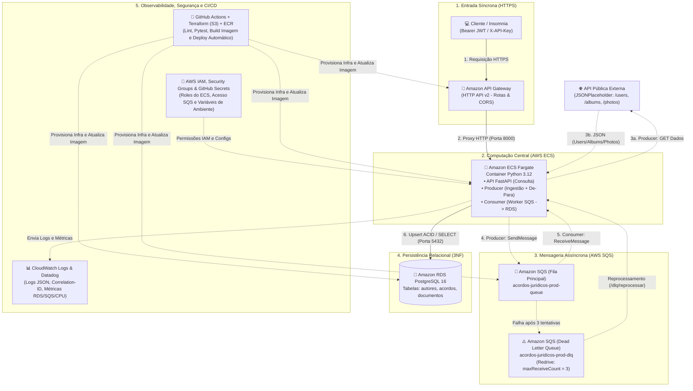

# Case Técnico: Consumo de API, Persistência e API de Consulta de Acordos Jurídicos (AWS)

Solução completa ponta a ponta desenvolvida em **Python 3.12**, **FastAPI**, **SQLAlchemy 2.0**, **PostgreSQL 16 (Amazon RDS)**, **AWS SQS + DLQ (LocalStack / AWS)**, **Amazon ECS Fargate**, **Amazon API Gateway HTTP v2**, **Terraform** e **Datadog** para modernizar o consumo, transformação (De-Para), persistência assíncrona resiliente e exposição RESTful de acordos jurídicos.

---

## 1. Parte 1 – Desenho da Arquitetura (AWS)

A arquitetura centraliza a computação no **Amazon ECS Fargate** (executando a **API FastAPI**, o **Producer** e o **Consumer**), integrando o **Amazon API Gateway** na entrada, a **API Pública Externa** na ingestão, o **Amazon SQS + DLQ** para mensageria assíncrona resiliente e o **Amazon RDS (PostgreSQL 16)** para persistência relacional.



### 1.1. Integrações Síncronas vs. Assíncronas
- **Integrações Síncronas**:
  1. **Coleta na API Pública (`Producer → JSONPlaceholder`)**: Requisições HTTP `GET` síncronas com *timeout* estrito e *retry* exponencial (`tenacity`) para absorver instabilidades de rede.
  2. **Consulta de Acordos (`Cliente → API Gateway → ECS Fargate FastAPI → RDS PostgreSQL`)**: Requisição HTTP/HTTPS síncrona de baixa latência, onde o cliente solicita os acordos de um autor (`GET /api/v1/usuarios/{id}/acordos`) e recebe a resposta imediatamente.
- **Integrações Assíncronas**:
  1. **Desacoplamento via Fila (`Producer → AWS SQS → Consumer`)**: Uma vez que o `Producer` monta o payload canônico de um autor, ele publica a mensagem no **AWS SQS** com um `CorrelationId` e encerra sua responsabilidade. O `Consumer` processa as mensagens no seu próprio ritmo (controle de concorrência/backpressure), protegendo o banco de dados de picos de escrita.
  2. **Tratamento de Falhas (`SQS → DLQ`)**: Caso uma mensagem falhe 3 vezes seguidas (`maxReceiveCount = 3`), o próprio SQS a move de forma assíncrona para a **Dead Letter Queue (DLQ)** sem travar o processamento dos demais autores.

### 1.2. Justificativa: Banco de Dados Relacional (PostgreSQL / RDS) vs. NoSQL (DynamoDB)
Foi escolhido o **PostgreSQL 16 (Amazon RDS)** em vez de um banco NoSQL pelos seguintes motivos técnicos e de negócio:
1. **Integridade Referencial Estrita (ACID e Foreign Keys)**: O domínio possui uma hierarquia fortemente relacional **Autor (1) → (N) Acordos (1) → (N) Documentos**. O uso de chaves estrangeiras (`ON DELETE CASCADE`) garante que jamais existam documentos órfãos de acordos ou acordos sem autor.
2. **Consultas Flexíveis e Analíticas**: Além da busca por `autor_id`, o domínio jurídico exige filtros combinados por nome parcial (`ILIKE`), segmento empresarial (`empresa_segmento`), título de acordo e agregações estatísticas (`COUNT`, `AVG`, `RANK() OVER`), que em bancos NoSQL exigiriam múltiplos *Global Secondary Indexes (GSIs)* custosos ou *Full Table Scans*.
3. **Upsert Transacional Atômico**: Na atualização de um autor com 10 acordos e 500 documentos, o PostgreSQL permite executar `session.merge()` dentro de uma única transação ACID: ou todos os registros do autor são atualizados com consistência, ou ocorre *rollback* completo.

### 1.3. Do Ambiente Local (LocalStack + Docker) para Produção na AWS
- **No ambiente local (`docker-compose.yml`)**: O container **LocalStack** emula a API do AWS SQS em `http://localstack:4566`, e o serviço `sqs-init` cria automaticamente a fila principal (`acordos-juridicos-queue`) e a DLQ (`acordos-juridicos-dlq`) com `RedrivePolicy`.
- **Em produção na AWS (`us-east-2`)**: Nenhuma linha de código muda. Basta omitir/deixar vazia a variável `AWS_ENDPOINT_URL` e utilizar as IAM Roles da Task ECS / Lambda. O SDK `boto3` passa a se conectar nativamente ao **Amazon SQS** gerenciado, e a string de conexão aponta para a instância **Amazon RDS PostgreSQL**.

### 1.4. Diferencial: Comparativo de Computação na AWS (Lambda vs. ECS Fargate vs. EKS)

| Critério | AWS Lambda | Amazon ECS Fargate *(Escolhido para a API)* | Amazon EKS (Kubernetes) |
| :--- | :--- | :--- | :--- |
| **Custo** | Cobrança por invocação e ms de execução (excelente para cargas esporádicas como Producer/Consumer). | Cobrança por vCPU/Memória provisionada por segundo (`0.25 vCPU / 512 MB` ≈ baixo custo previsível; pode zerar `desiredCount=0` fora de uso). | Alto custo fixo inicial ($73+/mês apenas pelo Control Plane por cluster, mais nós EC2/Fargate). |
| **Escalabilidade** | Escala de 0 a milhares de execuções simultâneas instantaneamente; sujeito a *Cold Start* e necessidade de *RDS Proxy* para não esgotar conexões PostgreSQL. | Escala horizontal automática de containers sem *Cold Start* por requisição; mantém *Connection Pool* SQLAlchemy ativo e estável com o RDS. | Altíssima escalabilidade (HPA/Karpenter), ideal apenas para dezenas/centenas de microsserviços complexos. |
| **Operação** | Zero gerenciamento de servidor; limite máximo de execução de 15 minutos por invocação. | Serverless para containers: sem gerenciamento de máquinas EC2, integração nativa com ALB/API Gateway, CloudWatch e ECR. | Alta complexidade operacional (atualização de versão do K8s, CNI, Ingress Controllers, RBAC). |

> **Conclusão Arquitetural**: O **ECS Fargate** oferece o melhor equilíbrio custo-benefício e operacional para a **API FastAPI** (sem *cold start*, mantendo pool de conexões com o RDS e telemetria contínua com o Datadog), enquanto o código do **Producer** e do **Consumer** foi escrito de forma híbrida (suportando execução tanto como Worker em Container quanto via `lambda_handler` no **AWS Lambda**).

---

## 2. Mapeamento Funcional e De-Para Obrigatório (Parte 2)

Hierarquia de domínio: **Autor (1) → (N) Acordos (1) → (N) Documentos**.

| Origem (API Pública JSONPlaceholder) | Destino (API de Acordos Jurídicos) | Regra de Transformação |
| :--- | :--- | :--- |
| `users.id` / `name` / `email` / `phone` | `autor.id` / `nome` / `email` / `telefone` | Mapeamento direto saneado |
| `users.address (street, suite, city, zipcode)` | `autor.endereco` | Formatado como `"{street}, {suite} - {city} CEP {zipcode}"` |
| `users.company.name` | `autor.empresa.nome` | Nome empresarial do autor |
| `users.company.bs` | `autor.empresa.segmento` | Segmento de atuação empresarial |
| `albums.id` / `title` | `acordos[].id` / `titulo` | Acordos vinculados ao `autor.id` |
| `photos.id` / `title` | `documentos[].id` / `titulo` | Documentos vinculados ao `acordo.id` |
| `photos.url` / `thumbnailUrl` | `documentos[].url` / `thumbnailUrl` | URLs completas e miniaturas comprobatórias |

**Os 6 endpoints implementados no `ExternalAPIClient` (`services/producer/client.py`):**
1. `GET /users` (`get_users`)
2. `GET /users/{id}` (`get_user_by_id`)
3. `GET /users/{id}/albums` (`get_user_albums`)
4. `GET /albums/{id}` (`get_album_by_id`)
5. `GET /albums/{id}/photos` (`get_album_photos`)
6. `GET /photos/{id}` (`get_photo_by_id`)

---

## 3. Como Executar e Testar (Parte 2 e Parte 3)

### 3.1. Subindo o Ambiente Completo com Docker Compose
Todo o bootstrap das filas SQS + DLQ no LocalStack e a criação do schema 3NF no PostgreSQL ocorrem automaticamente:

```bash
cd acordos-juridicos-aws
docker compose up --build -d
```

Acompanhe os logs estruturados (com `correlation_id`):
```bash
docker compose logs -f producer consumer api
```

### 3.2. Autenticação e Chamadas à API de Consulta de Acordos
- **Swagger UI**: `http://localhost:8000/docs`
- **ReDoc**: `http://localhost:8000/redoc`
- **Health Check**: `http://localhost:8000/health`

#### Opção A: Via `X-API-Key` (Endpoint sugerido no Case `/api/v1/usuarios/{id}/acordos`)
```bash
curl -X GET "http://localhost:8000/api/v1/usuarios/1/acordos" \
  -H "X-API-Key: chave-secreta-api-acordos-2026" \
  -H "X-Correlation-ID: req-teste-001"
```

#### Opção B: Via Token Bearer JWT
```bash
# 1. Gerar Token JWT
curl -X POST "http://localhost:8000/api/v1/auth/token" \
  -H "Content-Type: application/json" \
  -d "{\"username\": \"admin\", \"password\": \"admin123\"}"

# 2. Consultar Acordos com Paginação de Documentos e Mascaramento LGPD opcional
curl -X GET "http://localhost:8000/api/v1/usuarios/1/acordos?doc_page=1&doc_size=5&mascarar_dados=true" \
  -H "Authorization: Bearer <SEU_TOKEN_JWT>"
```

### 3.3. Principais Endpoints Disponíveis
| Método | Endpoint | Descrição |
| :--- | :--- | :--- |
| `GET` | `/health` | Healthcheck da aplicação e conexão com o PostgreSQL |
| `POST` | `/api/v1/auth/token` | Gera token JWT Bearer (`200` ou `401`) |
| `GET` | `/api/v1/usuarios/{autor_id}/acordos` | **Endpoint Principal do Case**: Retorna `autor`, `resumo` (`quantidadeAcordos`, `quantidadeDocumentos`) e `acordos[]` com `quantidadeDocumentos` e `documentos[]` (`200`, `400` id inválido, `401`, `404`) |
| `GET` | `/api/v1/autores/{autor_id}/acordos` | Rota equivalente semântica para consulta por autor |
| `GET` | `/api/v1/usuarios` ou `/api/v1/autores` | Lista autores paginados (filtros: `nome`, `segmento`, `mascarar_dados`) |
| `GET` | `/api/v1/acordos` | Lista acordos paginados (filtros: `autor_id`, `titulo`) |
| `GET` | `/api/v1/acordos/{acordo_id}` | Detalhes de um acordo específico, documentos e autor vinculado |
| `GET` | `/api/v1/acordos/{acordo_id}/documentos` | Lista os documentos de um acordo específico |
| `GET` | `/api/v1/documentos/{documento_id}` | Consulta um documento específico pelo ID |
| `GET` | `/api/v1/estatisticas` | Indicadores consolidados da base de acordos |
| `POST` | `/api/v1/dlq/reprocessar` | **Diferencial**: Reprocessa mensagens retidas na fila DLQ de forma idempotente |

---

## 4. Parte 4 – Operação, Monitoramento e Segurança (Respostas Obrigatórias)

### Pergunta 1: *Se a carga falhar no meio da execução, como você saberia que isso aconteceu e como faria para reprocessar?*
1. **Como saberíamos que falhou (Detecção)**:
   - **Logs Estruturados e Correlation ID**: Tanto o `Producer` quanto o `Consumer` emitem logs em formato JSON para o **CloudWatch Logs** e **Datadog** contendo `level: ERROR`, `correlation_id`, `autor_id`, `message_id` e o *stack trace* completo da exceção.
   - **Alarme na Dead Letter Queue (DLQ)**: Se o `Consumer` falhar ao gravar uma mensagem no banco após 3 tentativas (`maxReceiveCount = 3`), o SQS move automaticamente a mensagem para a fila `acordos-juridicos-prod-dlq`. A métrica `acordos.sqs.messages_visible{queue_type:dlq}` (e `ApproximateNumberOfMessagesVisible` no CloudWatch) sobe para `> 0`, disparando alerta imediato no Datadog/CloudWatch.
   - **Falha no Producer**: Caso a API externa fique indisponível mesmo após as 3 tentativas com *exponential backoff* (`tenacity`), o container/job encerra com código de saída diferente de zero (`exit code != 0`) e registra o erro no CloudWatch/Datadog.
2. **Como faríamos para reprocessar (Recuperação Segura)**:
   - **Idempotência Garantida por Design (`Upsert`)**: O `Consumer` utiliza `session.merge()` do SQLAlchemy baseado nas chaves primárias originais (`autor.id`, `acordo.id`, `documento.id`) dentro de uma transação atômica. Isso significa que **reprocessar a carga inteira ou reprocessar mensagens repetidas nunca duplica dados** — apenas atualiza registros existentes ou insere os faltantes.
   - **Reprocessamento da DLQ**: Basta acionar o endpoint autenticado `POST /api/v1/dlq/reprocessar` (ou `SQS StartMessageMoveTask` / redrive nativo da AWS), que lê as mensagens retidas na DLQ, executa o `process_payload` transacional e remove da DLQ apenas as que tiverem sucesso.
   - **Reexecução do Producer**: Se a falha ocorreu no meio da coleta da API pública, basta rodar novamente o `Producer` (`python -m services.producer.main`); os autores já processados sofrerão *upsert* idempotente e os pendentes serão inseridos normalmente.

---

### Pergunta 2: *Quais 3 métricas ou alertas você acompanharia para a API e para a carga? Por quê?*
1. **Mensagens Visíveis na DLQ (`acordos.sqs.messages_visible` com `queue_type:dlq` / `ApproximateNumberOfMessagesVisible > 0`)**:
   - **Por quê**: É o indicador definitivo de perda ou falha persistente na carga de dados. Qualquer valor maior que zero na DLQ significa que os acordos de pelo menos um autor não puderam ser persistidos após todas as retentativas automáticas e exigem ação ou *redrive*.
2. **Taxa de Erros HTTP 5xx e Latência p95 da API (`acordos.api.requests.total{status_class:5xx}` e `acordos.api.requests.latency_ms`)**:
   - **Por quê**: Mede diretamente a disponibilidade e a experiência dos sistemas jurídicos consumidores. Um aumento em erros `5xx` ou latência alta indica degradação no container ECS Fargate ou gargalo de consultas/conexões no banco RDS PostgreSQL.
3. **Idade da Mensagem Mais Antiga na Fila Principal (`ApproximateAgeOfOldestMessage` / `acordos.sqs.messages_visible{queue_type:main}`) e Uso de CPU/Memória do ECS/RDS (`aws.ecs.cpu.utilization`, `acordos.rds.active_connections`)**:
   - **Por quê**: Permite identificar atraso no processamento (*lag* do Consumer) caso a fila acumule mensagens sem vazão suficiente, além de prevenir exaustão de memória (*OOMKill* no Fargate) ou esgotamento do limite de conexões do PostgreSQL.

---

### Pergunta 3: *Que cuidados você teria com os dados pessoais dos autores (logs, resposta da API e banco de dados)?*
Em conformidade com a **LGPD (Lei Geral de Proteção de Dados - Lei nº 13.709/2018)** e boas práticas de segurança:
1. **Nos Logs (`CloudWatch` e `Datadog`)**:
   - **Proibição de PII em texto claro**: Os logs operacionais registram apenas identificadores técnicos (`autor_id`, `acordo_id`, `message_id`, `correlation_id`).
   - **Sanitização Automática no Formatter**: O `CloudWatchJsonFormatter` (`shared/config/logging.py`) possui filtros automáticos (`mask_email`, `mask_phone`) que mascaram qualquer campo `email` (ex.: `S***@april.biz`) ou `telefone` (ex.: `***-8031`) caso sejam acidentalmente passados no `extra_data`.
2. **Na Resposta da API**:
   - **Autenticação Obrigatória e Trânsito Criptografado**: Nenhum endpoint de dados funciona de forma anônima; todos exigem `Bearer JWT` com expiração ou `X-API-Key` trafegando exclusivamente sob **HTTPS/TLS** no API Gateway.
   - **Minimização e Mascaramento Sob Demanda**: A API expõe apenas os campos estritamente necessários ao domínio jurídico e oferece o parâmetro `mascarar_dados=true` (`GET /api/v1/usuarios/{id}/acordos?mascarar_dados=true`), que retorna e-mail (`S***@april.biz`), telefone (`***-6442`) e logradouro (`*** - Gwenborough CEP 92998-3874`) anonimizados para perfis de consulta restritos.
3. **No Banco de Dados (`Amazon RDS PostgreSQL`)**:
   - **Criptografia em Repouso e em Trânsito**: O RDS PostgreSQL opera com `storage_encrypted = true` (AWS KMS) para dados em disco e conexões exigindo SSL/TLS.
   - **Isolamento de Rede e Gestão de Segredos**: Em produção, o banco é protegido por *Security Groups* restritivos (aceitando tráfego na porta `5432` exclusivamente das Tasks do ECS/Consumer), credenciais gerenciadas via **AWS Secrets Manager** (sem senhas *hardcoded* no código) e controle de acesso baseado em menor privilégio (IAM Roles).

---

## 5. Executando Testes Automatizados e Linter Localmente

```bash
cd acordos-juridicos-aws
python -m pip install -r requirements.txt
ruff check shared services tests
pytest --cov=shared --cov=services --cov-report=term-missing --cov-fail-under=85
```
